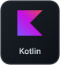
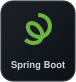
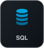
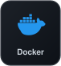

<!-- HEADER BANNER -->

  

 

<!-- TECH SKILLS -->
<h2 align="center">Habilidades Técnicas</h2>

### Frontend

&nbsp;
&nbsp;
&nbsp;
&nbsp;

### Backend

&nbsp;
&nbsp;
&nbsp;
&nbsp;
&nbsp;
&nbsp;

### Base de Datos

&nbsp;
&nbsp;
&nbsp;

### Herramientas

&nbsp;
&nbsp;
&nbsp;
&nbsp;
&nbsp;
&nbsp;
&nbsp;
&nbsp;

 

<!-- FOOTER -->

  

  

